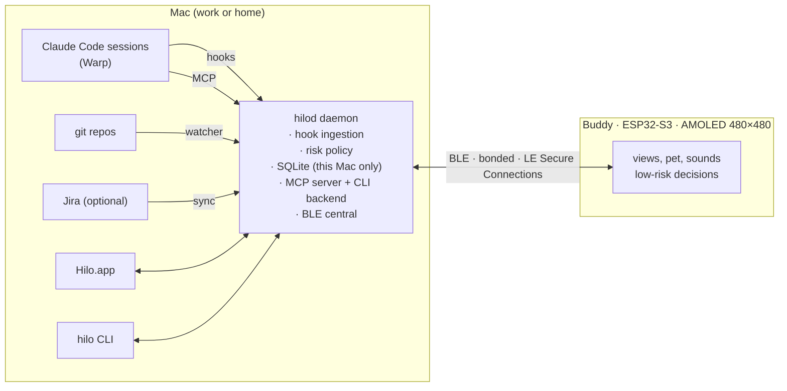

# Architecture overview

- The buddy may be bonded with both Macs at once. Every Mac → buddy event carries `host` to identify its origin.
- Each Mac has its own database. The buddy merges on screen what it receives from both; it never relays data between Macs.
- The buddy executes nothing. It displays state and returns decisions; the daemon decides whether to honor them.

## Repo layout (monorepo, proposed)

| Path | Contents |
| :--- | :--- |
| `firmware/` | ESP32-S3: display, BLE peripheral, audio |
| `daemon/` | `hilod`: hooks, BLE, SQLite, MCP, CLI |
| `hilo/` | macOS app UI |
| `shared/` | Event schema (single source) and generated types |
| `docs/` | This documentation |
| `prototypes/` | Approved visual references |

## Stack

| Part | Choice | Why |
| :--- | :--- | :--- |
| `hilod`, `hilo` CLI, Hilo.app | Swift (SwiftPM; SwiftUI for the app) | Official CoreBluetooth API, low idle power, login item via `SMAppService`, no npm packages in the process that approves permissions |
| Firmware | ESP-IDF + LVGL 9, NimBLE | Fine control of LE Secure Connections, two concurrent links, PSRAM and power |
| `shared/` | TypeScript on Node 24 | Schema tooling, fixtures and `buddy-emit`; the Swift code is tested against the same fixtures |

Local IPC between the hook command and `hilod`: [claude-code-hooks.md](claude-code-hooks.md#transport).
