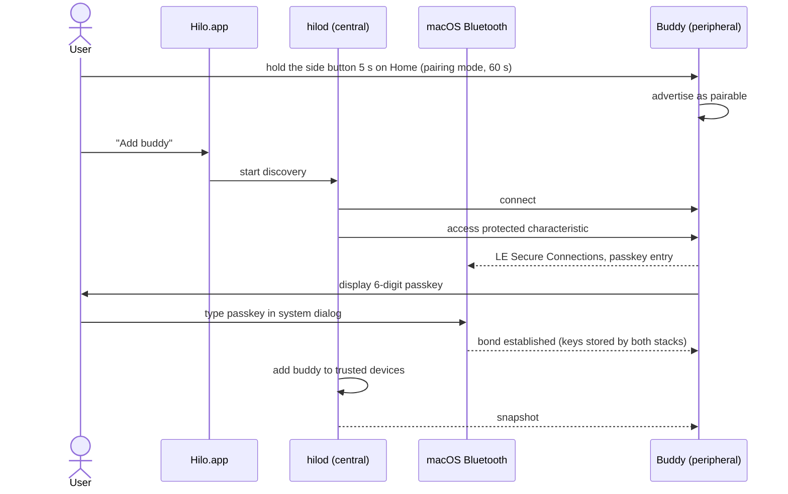
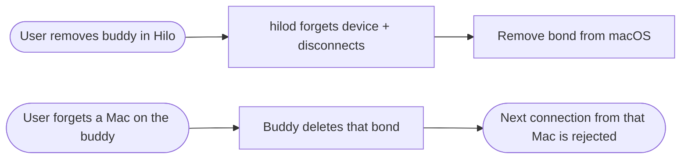

# BLE pairing flow

## Revocation

## Notes

- Unbonded or unencrypted connections are always rejected.
- Bonding keys are the only secret on the buddy.
- **Pending to define** ([open questions › BLE](../plans/open-questions.md#ble)): how to forget a Mac from the device, exact macOS pairing UX (CoreBluetooth hands pairing to the system dialog), pairing a second Mac while the first stays connected.
