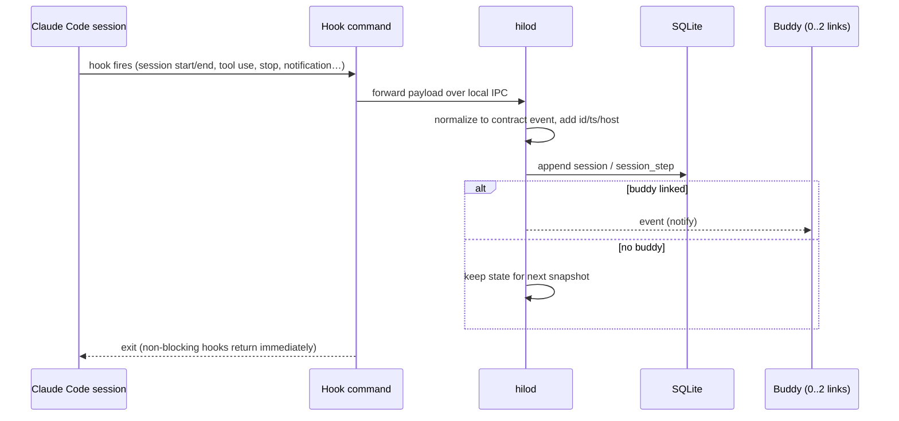

# Hook ingestion flow

## Notes

- Permission and question hooks are **blocking**; they follow the [remote decision flow](remote-decision-flow.md).
- The daemon must work without any buddy linked; Hilo keeps capturing.
- Logs never store full diffs or environment variables.
- **Pending to define** ([open questions › daemon](../plans/open-questions.md#daemon)): IPC transport and its permissions (e.g. a user-only Unix socket), behavior when `hilod` is not running (hook must fail open to the normal Mac prompt, never block Claude Code), mapping table from each Claude Code hook event to contract types — verify against current Claude Code hook docs.
