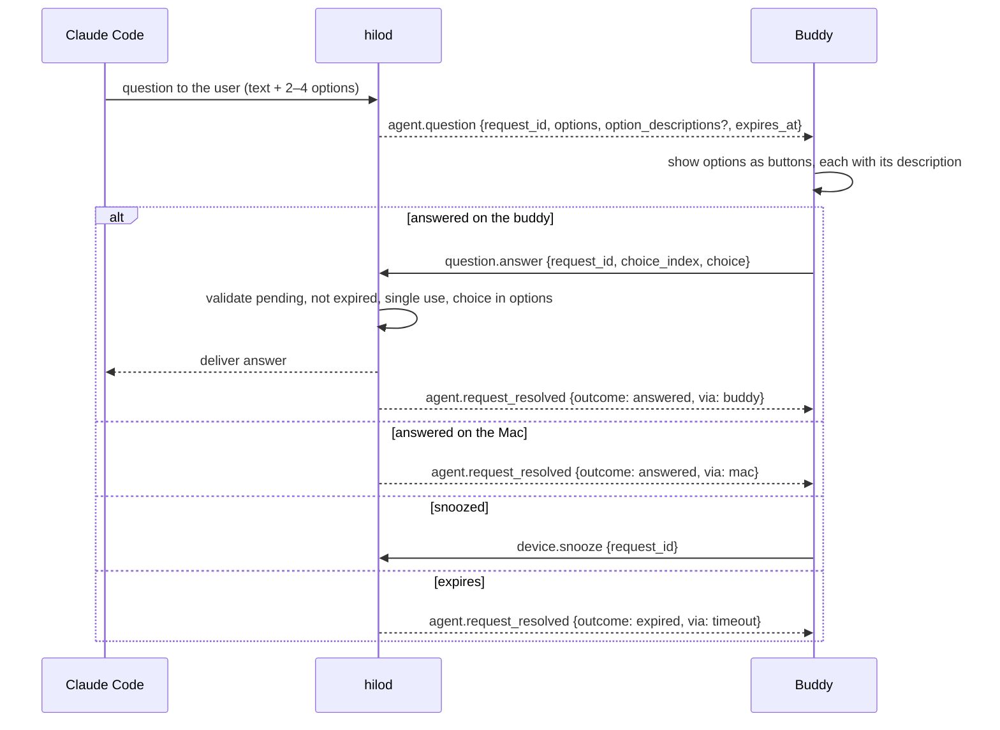

# Question flow

## Notes

- Questions have no risk level; any validated answer from a bonded buddy is accepted.
- The answer goes back through the `PreToolUse` hook: `permissionDecision: "allow"` and `updatedInput` echoing the questions plus `answers: { "<question>": "<label>" }` (see [Claude Code hooks](../architecture/claude-code-hooks.md)). Covered by `CoordinatorPhase4Tests` and `scripts/hilod-e2e.sh`; a real session taking the answer is still on the [hardware checklist](../plans/testing-strategy.md#remote-decisions-phase-4).
- Only one single-select question with 2–4 options reaches the buddy; anything else stays on the Mac.
