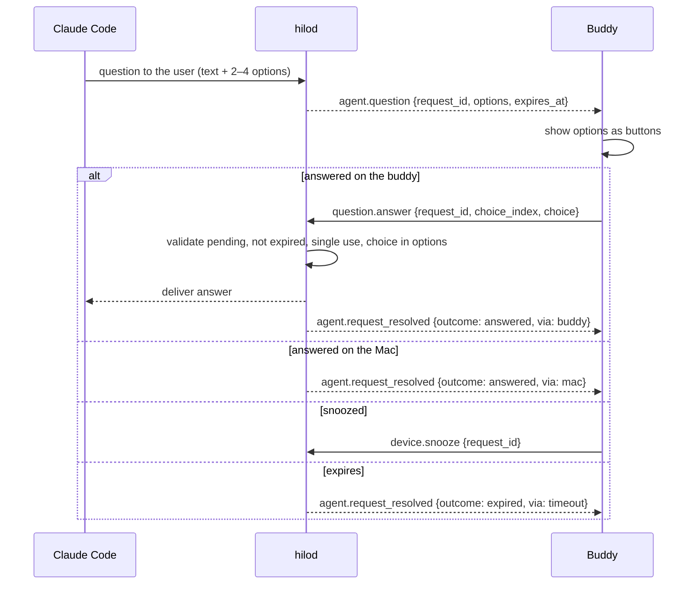

# Question flow

## Notes

- Questions have no risk level; any validated answer from a bonded buddy is accepted.
- **Pending to define** ([open questions › daemon](../plans/open-questions.md#daemon)): whether Claude Code hooks can inject an answer for a question at all — verify before committing to phase 4.
