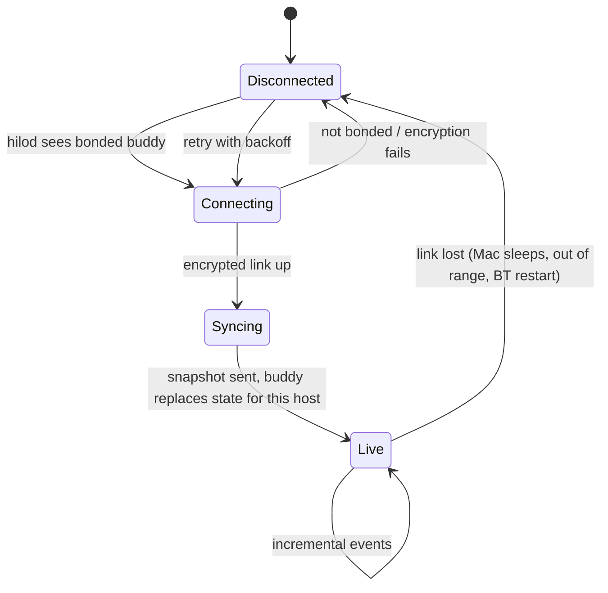

# Reconnect and snapshot flow

## On the buddy, per host

| Link state | Behavior |
| :--- | :--- |
| Live | Sessions shown normally; top-bar pill on |
| Lost | Pill off, "<host> Mac disconnected" alert, that host's sessions dimmed, its pending decisions hidden (they cannot be answered) |
| Back | `snapshot` replaces every session, usage and Hilo value for that host; no merging with stale data |

## Notes

- Two Macs are independent: losing one never affects the other's sessions.
- The daemon recovers by itself after a Bluetooth restart.
- **Pending to define** ([open questions › contract](../plans/open-questions.md#contract)): `snapshot` payload shape and size, backoff intervals, how usage/weekly values combine on screen when both Macs report them.
