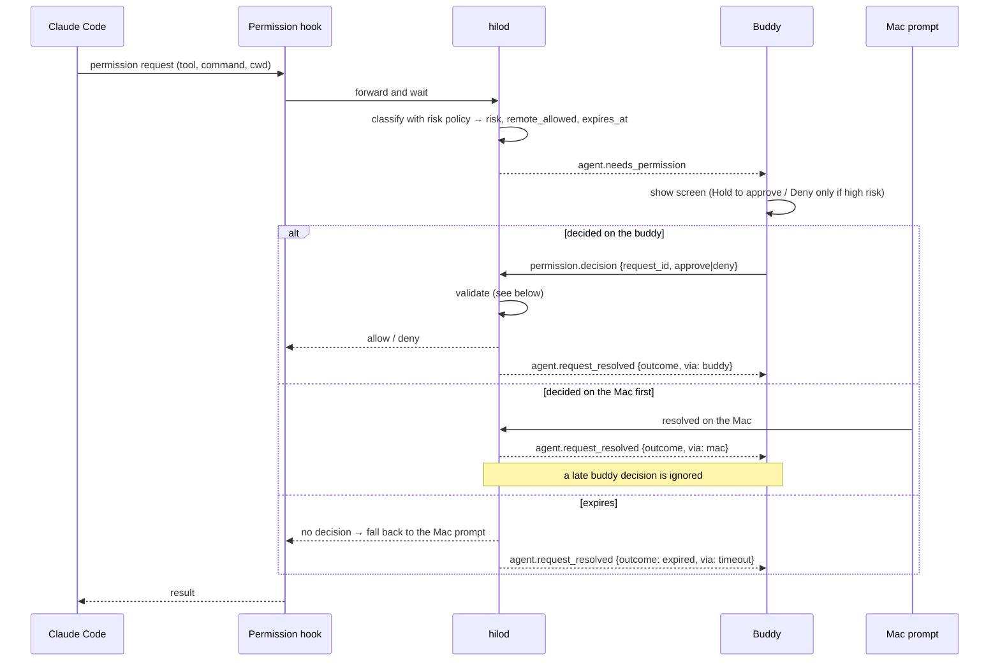
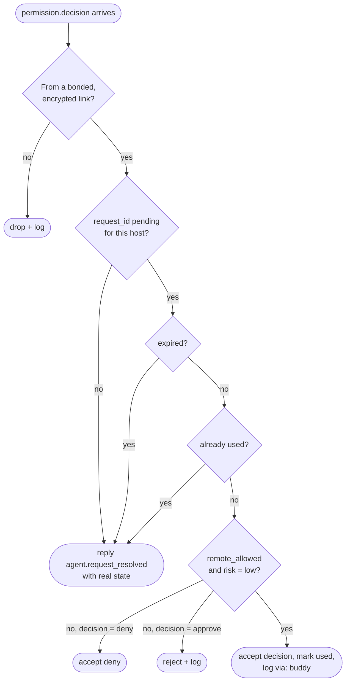

# Remote decision flow (permissions)

## Daemon validation

## Notes

- A **deny** from the buddy is always safe to honor, even for high-risk requests; an **approve** is honored only for `remote_allowed` + `low`.
- Default expiry: 10 min. "Later" on the device (`device.snooze`) keeps the request pending; the buddy reminds every 25 s.
- Every outcome is logged in the session timeline with `via`.
- **Pending to define** ([open questions › daemon](../plans/open-questions.md#daemon)): how the hook learns that the user answered in the terminal, whether the Claude Code hook timeout allows a 10-minute wait, and the exact fallback on expiry.
