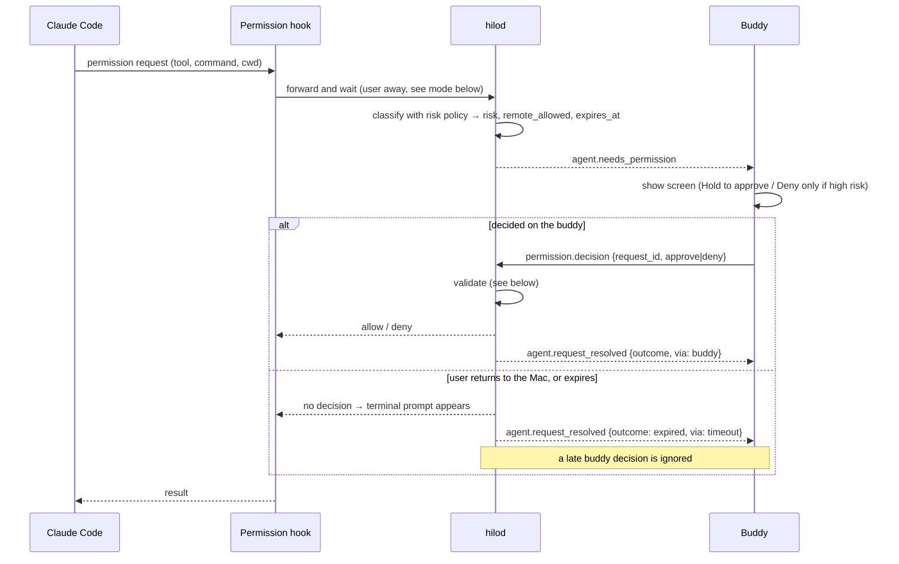
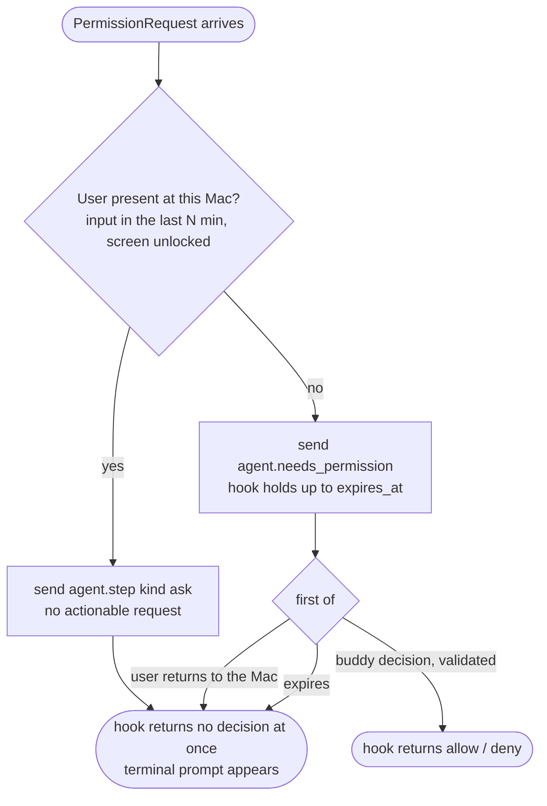

# Remote decision flow (permissions)

## Remote-decision mode

The permission hook holds only while the user is away from the Mac. While it holds, Claude Code shows no terminal prompt.

- Present: nothing on the buddy can be decided, because the hook has already handed the prompt to the terminal. The buddy only logs the step.
- Away: the daemon polls presence while holding. Coming back to the Mac, or reaching `expires_at`, releases the hook to the terminal prompt and closes the request on the buddy with `agent.request_resolved { outcome: "expired", via: "timeout" }`. The session stays `waiting` with nothing to answer: the buddy says "Answer it on the Mac" until the next step from that session (#19). While the buddy shows the request (its `device.ack` came in the last 30 s), coming back means 10 s of continuous input on the Mac (input within every 3 s), so a mouse nudge while reaching for the buddy does not take the request away (#21, decided 2026-10-27).
- The same mode applies to questions (`PreToolUse` on `AskUserQuestion`).

## Daemon validation

## Notes

- A **deny** from the buddy is always safe to honor, even for high-risk requests; an **approve** is honored only for `remote_allowed` + `low`.
- Default expiry: 10 min. "Later" on the device (`device.snooze`) keeps the request pending; the buddy reminds every 25 s.
- Every outcome is logged in the session timeline with `via`.
- **Pending to define** ([open questions › daemon](../plans/open-questions.md#daemon)): idle threshold for "away", and a hardware check that the terminal prompt stays hidden while the hook holds.
