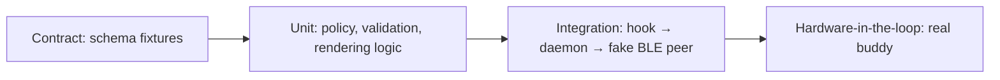

# Testing strategy

The safety rules (no remote high-risk approval, single-use decisions) must have automated tests before phase 4 ships.

| Layer | What to test | Tool | Run |
| :--- | :--- | :--- | :--- |
| Contract | Valid fixture per type passes; each invalid fixture fails; scenarios emit only valid events | `node:test` + ajv | `pnpm test` |
| Unit (daemon) | Risk policy classification; decision validation (pending, expiry, single use, high-risk approve rejected); Swift types vs. shared fixtures; the optional `tz_offset_min` (sent, reported, absent from older firmware, invalid refused) and the Setup offset list and "this Mac's" offset; `HiloStore` (tasks, session recording and auto-link, agreements, commits, activity spans, session tokens, week report and resume text, migrations); recorder → snapshot `hilo`; usage tracker, transcript tokens, git capture, config, control ops and pairing flow; secret redaction (`Redactor`, with a redacted shared fixture); LaunchAgent plist and `launchctl` sequence (fake runner); Pomodoro saved with its finished cycles and restored after a restart (no lost or repeated cycles); the phase-end notification (once per end, never for a change by hand or a stale end); `AppleScriptPlayer` with scripted apps (none open, Automation denied and retried, app quitting midway, playing over paused, 5 s timeout, an app switched off never asked and losing the controls; both off clearing the music and sending `media_enabled:false`; the `music` op reloading the switches and reporting Automation; Automation status codes; session looks (each session of a project gets the next accessory and a nudged hue, sent in `session.start`, kept in SQLite after the session ends and when it restarts, changed from the buddy and through the `session-look` op, an unknown session refused); status line detection (not wrapped, wrapped with a plain or quoted path, none, invalid JSON) and the Claude Code prompt text); a hand-back (expired) keeps the session waiting with no pending request until its next step, also in the snapshot after the user comes back and a slow player that must not block the coordinator; face chunks re-sent after a buddy reboot; covers (96×96 in 5 chunks under the cap, shared fixture hash, named in `media.now_playing` once read and sent only on request for the track playing now, a late cover for a previous track dropped, Spotify URLs only from `https://i.scdn.co`, Music.app raw artwork, faked players and downloads) | Swift Testing | `scripts/swift-test.sh` |
| Unit (firmware) | `buddy_model` (portable C) and the demo feed (2 h simulated, no rejected message): every shared fixture (valid accepted, invalid rejected except unknown fields), sort order, Home text, pet states, timers (idle 60 s, reminder 25 s, hold 900 ms, long press 650 ms, sleep clock shift), decisions; every message the buddy emits is validated against the schema; two Macs over real connections (one picture each, forgetting one frees its slot and its half-received picture, a third Mac turned away while both are linked, rotation in slot order); Pomodoro edges (flip exactly at `ends_at`, `updated_at` ties, counting alone through a dropped link, no start without the clock); the end-of-phase alarm (wakes on Focus without telling the Macs, bursts at 0/1/2 s every 5 s for 30 s, a tap, swipe or the button silences it and does nothing else, a Mac change silences it, a stale end does not ring); link times stamped once the clock is known; covers (asked once from the Mac that names it, assembled and shown only for the track that names it, wrong hash / gap / out of range dropped, a new Mac in the slot drops a half-received one); the time zone setting (`settings.set` and `device.settings` carry it, off-step and out-of-range refused, a panel change keeps it, the clock follows it); the waiting pixel cover (animates from the request until the cover arrives or 8 s pass, a seek does not restart the 8 s, only brightens and shuffles its own cells); session looks (`look` from `session.start` and snapshots, a bad hue or a look without `acc` refused, the Pet row cycling the accessory and sending `device.session_look` only to that session's Mac, the agent sheet staying on its session through snapshots and an older echo not undoing a newer pick; an open request and a Later surviving a snapshot); the Music view hidden only when every known Mac sends `media_enabled:false` (swipes skip it, a view on Music moves to Focus, a non-boolean refused); Claudio's eyes (pool sizes 8 / 7 / 5 / 4 / 3, a beat never repeating the last one and every beat reached, first beat 300–900 ms after a mood, gaze within whole cells, blinks every 2–6 s when idle and never asleep, done held 4 s but sleep at once, the done bounce and sparkles, sleep breathing one cell, reactions waiting for their start or the overlay and then handing back, each shape's cells against the prototype, the Face view first and back after 20 s without a touch but not over a sheet or the panel, moods following the agents, alerts over the Face with happy / blink / glance reactions); a request handed back to the Mac ("on the Mac" row and sheet, Home "Answer it on the Mac" behind a live request, tap opens the sheet, the next step back to working, the same from a snapshot, no reminder) | clang + UBSan, minimal harness in `firmware/test/` | `scripts/firmware-test.sh` |
| Integration | Hook payload → event → fake peripheral; reconnect sends `snapshot`; deny, single use, question answer echoed in `updatedInput`, mismatched answers, expiry at 600 s (fake clock) | Swift Testing (`Coordinator` with fake link, clock, presence); a real debug `hilod --stdout` driven by `hilo hook` and `hilo buddy` (deny, question, high-risk approve ignored, redaction, schema check) | `scripts/swift-test.sh`, `scripts/hilod-e2e.sh` |
| Visual parity | Firmware screens vs. `prototypes/buddy-sim.html` | Host render of the real LVGL UI and model to PNG for layout and text (`scripts/firmware-render.sh`: idle rotation, Focus (with the alarm ring) and Music scenes, the latter with a synthetic cover, the regenerating pixel cover and the 8 s give-up, Music skipped with both Macs' music off, three sessions of one project with their own accessories and the Pet picker, and Claudio's face: idle, calm dots, deep focus, pushing through, tracking, happy, hearts, wink, worried, the alert tile and its glance aside, the glance after Later, and the sleep rotation with the eyes on top over the clock, computers and Mac cards and a "z"; the hand-back toast, Home, Agents row and sheet); colour, contrast and feel on the board ([hardware checklist](#hardware-checklist)) | `scripts/firmware-render.sh` |
| Hardware | Pairing, two Macs, range loss, battery alerts, touch and timing feel | [Hardware checklist](#hardware-checklist) | — |

## Hardware checklist

Things only the board can confirm. Run them once flashing is approved; tick them in the commit that confirms them.

### Firmware phase 2 (views, pet, alerts, permission screen)

- [x] All five views, the overlays, the permission screen, the sheets, the toast and the sleep clock render without clipping at 480×480; fonts legible at their sizes. *2026-10-25: confirmed by hand on the board.*
- [x] Active view holds 30 fps or more with the pet animating (enable `LV_USE_PERF_MONITOR`); off-screen pets are not drawn. *2026-10-25, demo build (`sdkconfig.demo`): 55–64 fps, 7–10 ms render on Home and the permission screen. First run gave 22–26 fps: LVGL's software transform scaled the 224 px pet in ~28 ms, and the attention frame's border pulse redrew the whole screen; pets are now pre-scaled and the frame pulses as four edge strips.*
- [x] Pixel pets look crisp (nearest-neighbour) at 224, 192, 128, 76, 72 and 48 px. *2026-10-25: confirmed by hand on the board.*
- [x] Overlay and permission backgrounds use vertical gradients instead of the prototype's radial ones (complex gradients are off in LVGL); check they read well on the AMOLED. *2026-10-25: confirmed by hand on the board.*
- [x] Swipe left/right changes view; taps on agent rows, the usage ring, the Hilo card and sheet controls land on the right target; a swipe never also fires a tap. *2026-10-25: confirmed by hand on the board.*
- [x] Hold to approve fires at ~900 ms; lifting early or sliding off the button cancels it. *2026-10-25: confirmed by hand on the board.*
- [x] Side button on GPIO18: assumed active-low with the internal pull-up and a 40 ms debounce; click = back / Later / next view, hold 650 ms = sleep. *2026-10-25: active-low confirmed; click = back / Later / next view, the 650 ms sleep hold and the 5 s pairing hold all work.*
- [x] Sleep clock is dim and moves every 6 s; tap or button wakes. 2026-10-26: the panel now dims to 20 % on the sleep clock and goes back to 100 % on wake (serial `brightness 20%` after 60 s idle, `brightness 100%` when a link drop woke it); check by eye that 20 % still reads. *2026-10-25: dim, moves, tap and button wake to Home. Showed boxes for `--:--` before the time was known (fixed: `-` added to the digit fonts).*
- [x] Confetti burst on "Task done" does not drop frames. *2026-10-25: 37–61 fps during a burst (was ~20 fps for 1.5 s: 46 moving pieces overflowed LVGL's 32 invalid areas and forced full-screen redraws; they are now merged per tile). The 20-piece "Approved" burst is not measured yet.*
- [x] Heap after boot: model and pets live in PSRAM (`model … bytes` log line); no allocation failures over an hour of demo feed. *2026-10-25: `model 76520 bytes in psram`; over one hour of demo feed (one boot, no errors) internal heap stayed at ~196 KB free (low-water 94 KB) and PSRAM at 6.5 MB free, logged every minute.*
- [x] Battery from the AXP2101 (read only, polled every 5 s): level, USB and charging reach the top bar and `device.battery`. *2026-10-25: chip id `0x4a`, fuel gauge and battery ADC already on at power-up; reads 100 %, ~4190 mV, USB present, not charging (charge done).*
- [x] Settings from the Mac (default build, sound always compiled in): `settings.set` through `hilod`'s socket op `settings` is applied, confirmed with `device.settings` (shown in `status`), saved to NVS 2 s later, and a reconnect re-sends it. *2026-10-27: `{"sound":true,"volume":0}` → `settings sound 1, volume 0`, `settings saved`; Disconnected and Connected cues written at volume 0 (no audible sound); `{"brightness":90}` → `brightness 90%`; a reset loads the saved values. Internal heap after boot 150 KB (was ~163 KB before the audio task became permanent).*
- [ ] Settings panel by hand: swipe down opens it over any view (not over a permission, sheet or pairing screen), swipe up / tap below / side button closes it; dragging a slider changes brightness live and does not change view; Hilo › Setup follows within ~2 s. Then the reverse: change them in Setup and watch the panel follow. Time zone (2026-10-27): after flashing, the serial line `settings … tz -360 min` shows the old saved settings loaded with the UTC−6 default; − and + move the top bar clock by an hour and Setup's picker follows; "Use this Mac's" in Setup sets it back; a reset keeps it. *2026-10-27, flashed with the default build: `hilod` logged `buddy settings: sound on, volume 100, brightness 88%, UTC offset -360 min`, so the 4-byte blob saved before loaded with the default offset added. Left: the panel buttons and Setup by hand.*
- [x] Mac picture over BLE: `hilod` loads `face.png` next to its `config.json`, sends seven `host.face` chunks and the buddy stores it (serial `face host 0 work <hash>`, same hash as `status`); after a buddy reset it asks again with `device.face_request` and gets it in ~6 s. *2026-10-26: synthetic gradient picture through a scratch `HILO_CONFIG`; internal heap unchanged (low-water 64–66 KB with or without it).*
- [ ] Idle rotation by eye: pick a picture in Hilo › Setup, let the buddy sleep and watch clock → this Mac's card (name, picture, "connected … ago") every 8 s with the same drift; remove the picture and check it falls back to clock ↔ computers (one lit monitor, "1 Mac connected"); quit `hilod` and check "seen … ago" and the dark monitor. *2026-10-27, without the board: rendered on the Mac with `scripts/firmware-render.sh` (clock → computers with one lit and one dark monitor, "1 Mac connected" → the Mac's card with "connected 2 min ago" → after a disconnect "seen 1 min ago" → picture removed falls back to computers, "no Mac connected"); layout, text and the 6 s drift read as specified. Found on the way: a link that came up before the clock was known kept "connected" without "… ago" forever (fixed). Left for the board: a real picture at 80 % opacity on the AMOLED, the 8 s pace and the sleep brightness.*
- [x] Pomodoro from the Mac: socket op `pomodoro` (durations, toggle, reset) reaches the buddy, which applies it and answers `device.pomodoro`. *2026-10-26: three commands, three answers in the `hilod` log.*
- [ ] Focus view by eye: layout at 480×480, steppers and buttons land; start on the buddy and watch Hilo › Focus follow; pause in Hilo and watch the buddy; drop the link (quit `hilod`) mid-work and check it keeps counting and both agree after reconnect; with sound on, hear the cue at the phase change. *2026-10-27, without the board: rendered on the Mac (stopped with steppers, play dimmed without the clock, running and paused with the steppers hidden, break with "3 done", link down keeps counting with dim pills, back to work after a phase change alone, 90/4 limits); model tests cover the phase flip at `ends_at`, `updated_at` ties and counting through a dropped link, and `hilod` keeps the timer across its own restart. Left for the board: touch targets, the cue, and Hilo › Focus following live. *2026-10-27: the phase end now rings the alarm (model tests, render `focus-alarm-*`). On the board: let a 1 min break end while asleep with sound on at volume 20: it wakes on Focus at full brightness, the ring pulses, three Success cues every 5 s at volume 60 for 30 s; a tap anywhere stops it without pressing what is under the finger; Hilo.app shows "Break time" (allow notifications the first time).* Note: the buddy still falls asleep after 60 s on a running Focus view (see [open questions](open-questions.md#firmware)).*
- [ ] Music end to end: open Spotify and play; accept macOS's "hilod wants to control Spotify" prompt (note whether it appeared at all under launchd; if not, follow the Music source fallbacks in [open questions](open-questions.md#hilo)); the buddy's Music view shows title, artist and progress within ~3 s, pause shows ▶, seeking jumps the bar; previous / play-pause / next on the buddy act on Spotify; quit Spotify and the view goes back to "Nothing playing". Repeat once with Music.app. *2026-10-27, without the apps: scripted-app tests for none open, Automation denied (-1743: logged once, retried every 5 min), the app quitting midway and playing-over-paused; AppleScript now runs off the coordinator with a 5 s timeout, so a pending prompt cannot hold up hooks.*
- [ ] Music setup (#12): build `Hilo.app` (`scripts/build-hilo-app.sh`), open Setup › Music with Spotify open, press "Allow control" and accept the prompt (Hilo: allowed); turn both switches off and watch the buddy drop the Music view (dot gone, swipes skip it) and `hilod` log `music: off`; turn one back on. *2026-10-27, scratch `hilod` (`--stdout`, scratch config with both off) and `HILO_SNAPSHOT`: the snapshot carried `"media_enabled":false`, `hilod` logged `music: off`, and the step showed both switches off with Spotify allowed and Music.app closed for Hilo and `hilod`.*
- [ ] Status line prompt (#17): in Setup › Usage press "Copy prompt for Claude Code", paste it into a Claude Code session, check the backup and the diff before accepting, then confirm the step turns done and the buddy's ring moves after the next reply. *2026-10-27, `HILO_SNAPSHOT` with a scratch `CLAUDE_CONFIG_DIR`: a plain command shows "does not go through hilo statusline yet", a wrapped one ticks the step.*
- [ ] Pets per session (#14): start two Claude Code sessions in the same repo; on the buddy's Agents view they share a colour family with different accessories; open one, change its Pet with ‹ ›, and check Hilo › Sessions follows within ~2 s; change it in Hilo and check the buddy follows; end the session and reopen Sessions: it keeps its pet. *2026-10-27, scratch `hilod` and `HILO_SNAPSHOT`: three `SessionStart` hooks in one repo went out with shades / headphones / crown at hues 91 / 105 / 77, and Hilo › Sessions drew them with a "Pet: Shades" menu. 2026-10-27, found on the board: the sheet closed after each ‹ › (fixed in the firmware) and Hilo › Sessions kept the old pet. The store had the new pick; the Hilo.app in use was built before pets per session, so it drew the project look. With the current app a buddy pick (`device.session_look` through a scratch `hilod`) showed in Sessions on the next 2 s refresh; rebuild Hilo.app (`scripts/build-hilo-app.sh`) after a contract change.*
- [ ] Music cover: play a track with artwork in Music.app, then one in Spotify; within a few seconds of the track change the buddy logs `cover <hash> 96x96` and the Music view shows the real cover with rounded corners (the generated pixel cover until then); a track without artwork keeps the pixel cover; the `hilod` log shows `cover <hash>` once per track and no download for Music.app. *2026-10-27, without the apps: Swift tests with faked players and downloads, model tests, and the host render (`music-cover-requested` → `music-cover`).* *2026-10-27, on the board with the default build and the launchd `hilod`, whatever was already playing: `hilod` logged `cover e217b9a69399ec95`, the buddy took five 6.2 KB `media.cover` chunks about 1 s apart and logged `cover e2d79e1189e3b903 96x96` for the next track; internal heap low-water 56 KB (was 64–66 KB). Left: look at it on the AMOLED, a track without artwork, and which app was playing. *2026-10-27: while a cover is on its way the pixel cover now animates (host render `music-cover-regenerating`, `music-cover-gave-up`); on the board, change track with the Music view open and check it shimmers until the cover lands and the frame rate stays above 30 fps (`LV_USE_PERF_MONITOR`): it redraws only the 150 px cover, 10 times a second.*
- [x] Hilo › Setup › Buddy settings with scratch data: a scratch `hilod --stdout` (`HILO_CONFIG`, `HILO_DB`, `HILO_SOCKET=h.sock`), a `device.settings` sent with `hilo buddy`, then `HILO_SNAPSHOT`: `setup-full.png` shows Sound on, Volume 35, Brightness 70 % as reported; the socket op `settings` the controls use made `hilod` emit `settings.set {"brightness":40,"volume":80}`. *2026-10-27. The app used to ignore `HILO_SOCKET` (only the CLI read it), so it always talked to the real `hilod`; fixed. Snapshots draw no accent colours, so the Sound switch looks grey even when on; check by eye on the real app.*
- [ ] Hilo.app by eye on macOS 26 (`HILO_SNAPSHOT` cannot draw glass): the top bar shows Liquid Glass; scrolling Today or Setup fades content under the bar; dragging the bar moves the window; a double click zooms (or minimizes / nothing, per Desktop & Dock); quitting and reopening keeps size and position; View › Enter Full Screen works; ⌘1…⌘7 switch sections.
- [ ] Unplug USB: still on battery, no "Charging" toast; plug it back with the battery below full: "⚡ Charging" toast and Success sound. Let it drop to 15 %: "Low battery" alert once, Problem sound.
- [x] The PCF85063 is written whenever a Mac sets the clock and read at boot, so the sleep clock shows the time before any Mac connects. *2026-10-25: first boot found the oscillator-stop flag set (never written) and wrote it from the snapshot; after a reset the clock came from the RTC 2 s behind the Mac.*
- [x] Sound path through the ES8311: codec opens, the synthesized cue is written to I²S at 22 050 Hz and the codec closes after 2 s of silence. *2026-10-25, checked silently at volume 0: "Connected" (12 525 samples, 568 ms) written in 560 ms with no error; internal heap after boot drops ~13 KB with sound on.*
- [ ] Turn sound on from the settings panel (swipe down) at volume 60 and listen next to `prototypes/buddy-sim.html`: each of the 17 cues matches the prototype's family timbre, notes and rhythm (Permission, Question, High risk, Reminder at half volume; Task done, Approved, Connected, Charging with the bell tail; Error, Usage 80 %, Limit, Battery, Disconnected low and filtered; New session, Denied, Song, Button short and high). Report the volume that feels right and whether the speaker buzzes or pops when the codec opens or closes.
- [ ] Discharge run: unplug USB at 100 % and keep the serial log open (or note the top bar) until 15 %; the `battery … up N min, sleeping` line every 60 s gives %/h awake and on the sleep clock for the [battery target](open-questions.md#firmware).
- [ ] Clock after a full power-off (USB unplugged, battery out of the PMU path): the PCF85063 keeps time only if its backup supply holds.
- [x] LVGL runs from flash (`LV_ATTRIBUTE_FAST_MEM_USE_IRAM` is off so NimBLE fits in IRAM); confirm the frame rate above still holds. *2026-10-25: holds (see above). Turning it on does not link even in the demo build, since the BT controller is always compiled in.*

- [ ] Claudio's eyes by eye (default build, after flashing): the buddy boots on the orange Face with the eyes centred at x 100 / 380, y 176; let an agent work and watch the working looks change without repeating; swipe to Home and wait 20 s: back to the Face; a permission takes the screen with the eyes in the orange corner tile; approve and watch the ^ ^ after the "Approved" overlay; Later gives a glance aside; on the sleep screen the eyes sit on top on ember with the clock and cards below, drifting together. Check the orange against the printed case and that the 8 px cells read crisp. *2026-10-27, demo build (`sdkconfig.demo`, `LV_USE_PERF_MONITOR`, about 3 min of the demo feed, untouched): 64–66 fps on the Face and the sleep screen with 0–4 ms renders; 37–54 fps for a second or two while an overlay or the permission screen opens (renders up to 28 ms, as before the eyes); heap after boot internal 225 KB free (low-water 159 KB), PSRAM 5.83 MB free. Not yet looked at by eye: the demo ran untouched and the board went back to the default build.*

- [ ] Hand-back (#19 b): with `hilod` holding a permission for the buddy, nudge the mouse on the Mac: the buddy closes the prompt with the "Answer it on the Mac" toast; Home says "Answer it on the Mac" / "<project> · handed back", the Agents row reads "on the Mac" and the sheet "Answer it on the Mac."; answer in the terminal and, with the next tool step, the row goes back to working. *2026-10-27: host tests and the render `handback-*` only.*

### BLE peripheral

- [x] Hold the side button 5 s on Home: pairing screen appears and the buddy shows up as `Hilo Buddy` in a scan; it closes after 60 s or on Cancel / side button. *2026-10-25: screen appears, advertising turns discoverable (`disc_mode=2`), shows as `Hilo Buddy` in a scan and closes after exactly 60 s, on Cancel and on the side button. `hilod` logs `found buddy` without the name.*
- [x] Pairing from macOS shows the system passkey dialog; the code on the buddy matches; the bond survives a reboot (NVS). *2026-10-25: confirmed; after several reflashes the Mac reconnects as `secure (bonded)` without a passkey.*
- [ ] Outside pairing mode an unbonded central is disconnected within 10 s and never reaches `rx`; a bonded Mac reconnects on its own.
- [ ] Bonded Macs using a resolvable private address are recognised after reconnecting. *2026-10-25: the test Mac connects with a public address, so this is still open.*
- [x] Negotiated MTU (log `mtu`) and an 8 KB snapshot round trip; notifications do not fail with out-of-mbuf on a burst. *2026-10-25: MTU 517; a 7681-byte snapshot (16 injected sessions, trimmed by `hilod`) arrives in ~1.2 s and is accepted. The buddy only sends single-frame messages so far, so no notify burst occurs.*
- [ ] Two Macs connected at once; each only receives the messages for its host. *2026-10-27, model only: two connections each bound to its Mac with its own picture, a picture sent for the other Mac rejected, rotation in slot order, a disconnected Mac keeping its picture until a third Mac needs the slot (then its sessions, picture and any half-received picture go; the new Mac alone is asked for its picture), a third Mac turned away while both are linked. Left for the board: two real links and the heap during both snapshots.*
- [x] Non-discoverable connectable advertising is enough for CoreBluetooth to reconnect a known peripheral. *2026-10-25: every reconnect ran with `disc_mode=0`.*
- [x] `hilod` first run triggers the macOS Bluetooth permission prompt (embedded `Info.plist`); `hilod --pair` finds the buddy, pairs and writes `buddies.json`. *2026-10-25: only when started by launchd; from a terminal macOS aborts it (see [open questions](open-questions.md#daemon)). Every rebuild asks again.*
- [x] Plain `hilod` reconnects after the buddy reboots and after toggling Bluetooth on the Mac, and sends a `snapshot` each time. *2026-10-25: reconnects in 7–22 s with a snapshot each time. Found and fixed on the way: clipped `agent.step` / `task_done` text was rejected by the buddy, a timed-out overlapping security procedure dropped bonded links after 30 s, and `hilod` busy-looped while Bluetooth was off.*

### Remote decisions (phase 4)

- [x] A low-risk permission (`npm test` inside the repo) held while the user is away shows Hold to approve on the buddy; approving returns `allow` to the hook. *2026-10-25: a synthetic `PermissionRequest` piped into `hilo hook`; approved on the board, hook answered `allow` 4 s after the request.*
- [x] A high-risk permission (`pnpm test` is not in the default allowlist) shows "Mac only" on the buddy and cannot be approved there. *2026-10-25.*
- [x] With input on the Mac in the last `--away-after` seconds the request is not held and the prompt stays in the terminal. *2026-10-25. On a laptop, a palm resting near the trackpad keeps resetting the idle time (`UserIsActive` from the internal trackpad every few seconds), see [open questions](open-questions.md#daemon).*
- [x] Coming back to the Mac releases a held request to the terminal and closes it on the buddy. *2026-10-25: works. The buddy said "expired", which read like a timeout; it now says "Answer it on the Mac".*
- [ ] Deny from the buddy returns `deny` to the hook. *2026-10-26, without the board: covered by `CoordinatorPhase4Tests` and `scripts/hilod-e2e.sh` (real `hilod` and `hilo hook`). Left for the board: tapping Deny on the permission screen sends `permission.decision` and the screen closes.*
- [ ] A question (`AskUserQuestion`) answered on the buddy reaches Claude Code. *2026-10-26, without the board: the hook prints `permissionDecision: allow` with `updatedInput` = the original input plus `answers: {question: label}` (tests and `scripts/hilod-e2e.sh`). Left for the board: the buddy's question screen sends the right `choice_index`/`choice`, and a real Claude Code session takes the answer without asking in the terminal.*
- [x] A real Claude Code session (not a synthetic payload) is held, approved on the buddy, and the tool runs with no terminal prompt. *2026-10-25: `claude --permission-mode default`, `npm test`, with `hilod --always-away`: no terminal prompt, approved on the board, the command ran. With presence detection the request was never held: see "Presence decided once" in [open questions](open-questions.md#daemon). In auto mode Claude Code sends no `PermissionRequest` at all.*
- [ ] A held request expires after 600 s and the hook falls back to the terminal prompt. *2026-10-26, without the board: a fake clock releases permissions and questions at exactly 600 s (not at 599 s) and a late answer is rejected. Left for the board: after 10 real minutes the buddy closes the request and Claude Code shows its prompt (hook timeout 660 s in `hooks.example.json`).*

### Hilo setup (phase 5)

- [x] `hilod` answers the socket op `status` with host, buddy link and pairing state. *2026-10-25: `{"host":"work","buddy":{"link":"connected","pairing":"idle"}}` from the running daemon.*
- [ ] In Hilo › Setup, rename this Mac (e.g. Home, then back to Work): the buddy's top bar and session rows follow within a few seconds, and `~/Library/Application Support/Hilo/config.json` holds the new host. *Not run tonight: renaming the live host was blocked as a change to shared state.*
- [ ] `hilo install` (or Start in Setup) replaces the current `launchctl submit` job with the LaunchAgent: `launchctl print gui/$(id -u)/dev.hilo.hilod` shows the plist path, the buddy reconnects, and after a logout/login `hilod` is running again with no Bluetooth prompt. `hilo uninstall` (or Stop) leaves no job and no plist.
- [ ] Stop and start `hilod` from Setup. Start installs the LaunchAgent for the copy bundled in `Hilo.app`: check macOS does not ask for Bluetooth again (same signing identity and identifier as `daemon/.build/release/hilod`) and the buddy reconnects.
- [ ] Guided pairing from Setup with a second buddy, or after forgetting this one on both sides: hold 5 s, Start pairing, "Found Hilo Buddy", passkey dialog, "Paired". Also Cancel mid-scan and a 60 s timeout with no buddy in pairing mode (the paired buddy must reconnect afterwards).

- [ ] Automatic capture on real work: commit in a repo where a Claude Code session ran today; within a minute it shows under the task in progress (Today), in Resume and in Week's commit count; active time grows while the session works and stops after 5 min idle. *Rendered with seeded scratch data on 2026-10-25 (layout only).*

### Usage (phase 3)

- [x] A status line payload piped into `hilo statusline` reaches `hilod`, which sends `usage.update` and the buddy accepts it. *2026-10-25: synthetic payload (33 % / 21 %), buddy `rx 176 bytes`, no rejection.*
- [x] `--tokens-from-transcripts` counts today's tokens from the local transcripts. *2026-10-25: ~3.0 M tokens on the dev Mac (input + cache writes + output).*
- [ ] With `tokens_from_transcripts` on, Hilo › Sessions shows each session's tokens within a minute of a reply, and a session with subagents counts theirs too.
- [ ] With `hilo statusline -- <your status line command>` in `~/.claude/settings.json`, the buddy's Usage ring and Home stats match Claude Code's `/usage` within a minute of a reply, and the existing status line still prints. *2026-10-27 (#16): not checked: the status line still runs its own script without `hilo statusline`, and the launchd `hilod` log has no usage from today's replies. Wrap it with the prompt from Setup › Usage (#17), then check this.*

