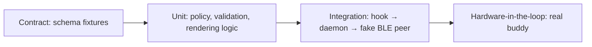

# Testing strategy

> **Pending to define.** Fill per component once stacks are chosen. The safety rules (no remote high-risk approval, single-use decisions) must have automated tests before phase 4 ships.

| Layer | What to test | Tool | Run |
| :--- | :--- | :--- | :--- |
| Contract | Valid fixture per type passes; each invalid fixture fails; scenarios emit only valid events | `node:test` + ajv | `pnpm test` |
| Unit (daemon) | Risk policy classification; decision validation (pending, expiry, single use, high-risk approve rejected); Swift types vs. shared fixtures; `HiloStore` (tasks, session recording and auto-link, agreements, commits, activity spans, migrations); recorder → snapshot `hilo`; usage tracker, transcript tokens, git capture, config, control ops and pairing flow | Swift Testing | `scripts/swift-test.sh` |
| Unit (firmware) | `buddy_model` (portable C) and the demo feed (2 h simulated, no rejected message): every shared fixture (valid accepted, invalid rejected except unknown fields), sort order, Home text, pet states, timers (idle 60 s, reminder 25 s, hold 900 ms, long press 650 ms, sleep clock shift), decisions; every message the buddy emits is validated against the schema | clang + UBSan, minimal harness in `firmware/test/` | `scripts/firmware-test.sh` |
| Integration | Hook payload → event → fake peripheral; reconnect sends `snapshot` | Swift Testing (`Coordinator` with fake link, clock, presence); manual run in `daemon/README.md` | `scripts/swift-test.sh` |
| Visual parity | Firmware screens vs. `prototypes/buddy-sim.html` | Manual, on the board ([hardware checklist](#hardware-checklist)) | — |
| Hardware | Pairing, two Macs, range loss, battery alerts, touch and timing feel | [Hardware checklist](#hardware-checklist) | — |

## Hardware checklist

Things only the board can confirm. Run them once flashing is approved; tick them in the commit that confirms them.

### Firmware phase 2 (views, pet, alerts, permission screen)

- [x] All five views, the overlays, the permission screen, the sheets, the toast and the sleep clock render without clipping at 480×480; fonts legible at their sizes. *2026-10-25: confirmed by hand on the board.*
- [x] Active view holds 30 fps or more with the pet animating (enable `LV_USE_PERF_MONITOR`); off-screen pets are not drawn. *2026-10-25, demo build (`sdkconfig.demo`): 55–64 fps, 7–10 ms render on Home and the permission screen. First run gave 22–26 fps: LVGL's software transform scaled the 224 px pet in ~28 ms, and the attention frame's border pulse redrew the whole screen; pets are now pre-scaled and the frame pulses as four edge strips.*
- [x] Pixel pets look crisp (nearest-neighbour) at 224, 192, 128, 76, 72 and 48 px. *2026-10-25: confirmed by hand on the board.*
- [x] Overlay and permission backgrounds use vertical gradients instead of the prototype's radial ones (complex gradients are off in LVGL); check they read well on the AMOLED. *2026-10-25: confirmed by hand on the board.*
- [x] Swipe left/right changes view; taps on agent rows, the usage ring, the Hilo card and sheet controls land on the right target; a swipe never also fires a tap. *2026-10-25: confirmed by hand on the board.*
- [x] Hold to approve fires at ~900 ms; lifting early or sliding off the button cancels it. *2026-10-25: confirmed by hand on the board.*
- [x] Side button on GPIO18: assumed active-low with the internal pull-up and a 40 ms debounce; click = back / Later / next view, hold 650 ms = sleep. *2026-10-25: active-low confirmed; click = back / Later / next view, the 650 ms sleep hold and the 5 s pairing hold all work.*
- [x] Sleep clock is dim and moves every 6 s; tap or button wakes. Brightness is not lowered yet (no brightness policy). *2026-10-25: dim, moves, tap and button wake to Home. Showed boxes for `--:--` before the time was known (fixed: `-` added to the digit fonts).*
- [x] Confetti burst on "Task done" does not drop frames. *2026-10-25: 37–61 fps during a burst (was ~20 fps for 1.5 s: 46 moving pieces overflowed LVGL's 32 invalid areas and forced full-screen redraws; they are now merged per tile). The 20-piece "Approved" burst is not measured yet.*
- [x] Heap after boot: model and pets live in PSRAM (`model … bytes` log line); no allocation failures over an hour of demo feed. *2026-10-25: `model 76520 bytes in psram`; over one hour of demo feed (one boot, no errors) internal heap stayed at ~196 KB free (low-water 94 KB) and PSRAM at 6.5 MB free, logged every minute.*
- [x] Battery from the AXP2101 (read only, polled every 5 s): level, USB and charging reach the top bar and `device.battery`. *2026-10-25: chip id `0x4a`, fuel gauge and battery ADC already on at power-up; reads 100 %, ~4190 mV, USB present, not charging (charge done).*
- [ ] Unplug USB: still on battery, no "Charging" toast; plug it back with the battery below full: "⚡ Charging" toast and Success sound. Let it drop to 15 %: "Low battery" alert once, Problem sound.
- [x] The PCF85063 is written whenever a Mac sets the clock and read at boot, so the sleep clock shows the time before any Mac connects. *2026-10-25: first boot found the oscillator-stop flag set (never written) and wrote it from the snapshot; after a reset the clock came from the RTC 2 s behind the Mac.*
- [x] Sound path through the ES8311 (`CONFIG_BUDDY_SOUND`): codec opens, the synthesized cue is written to I²S at 22 050 Hz and the codec closes after 2 s of silence. *2026-10-25, checked silently at volume 0: "Connected" (12 525 samples, 568 ms) written in 560 ms with no error; internal heap after boot drops ~13 KB with sound on.*
- [ ] Listen with `sdkconfig.sound` (volume 60, see [firmware/README](../../firmware/README.md#build)) next to `prototypes/buddy-sim.html`: each of the 17 cues matches the prototype's family timbre, notes and rhythm (Permission, Question, High risk, Reminder at half volume; Task done, Approved, Connected, Charging with the bell tail; Error, Usage 80 %, Limit, Battery, Disconnected low and filtered; New session, Denied, Song, Button short and high). Report the volume that feels right and whether the speaker buzzes or pops when the codec opens or closes.
- [ ] Clock after a full power-off (USB unplugged, battery out of the PMU path): the PCF85063 keeps time only if its backup supply holds.
- [x] LVGL runs from flash (`LV_ATTRIBUTE_FAST_MEM_USE_IRAM` is off so NimBLE fits in IRAM); confirm the frame rate above still holds. *2026-10-25: holds (see above). Turning it on does not link even in the demo build, since the BT controller is always compiled in.*

### BLE peripheral

- [x] Hold the side button 5 s on Home: pairing screen appears and the buddy shows up as `Hilo Buddy` in a scan; it closes after 60 s or on Cancel / side button. *2026-10-25: screen appears, advertising turns discoverable (`disc_mode=2`), shows as `Hilo Buddy` in a scan and closes after exactly 60 s, on Cancel and on the side button. `hilod` logs `found buddy` without the name.*
- [x] Pairing from macOS shows the system passkey dialog; the code on the buddy matches; the bond survives a reboot (NVS). *2026-10-25: confirmed; after several reflashes the Mac reconnects as `secure (bonded)` without a passkey.*
- [ ] Outside pairing mode an unbonded central is disconnected within 10 s and never reaches `rx`; a bonded Mac reconnects on its own.
- [ ] Bonded Macs using a resolvable private address are recognised after reconnecting. *2026-10-25: the test Mac connects with a public address, so this is still open.*
- [x] Negotiated MTU (log `mtu`) and an 8 KB snapshot round trip; notifications do not fail with out-of-mbuf on a burst. *2026-10-25: MTU 517; a 7681-byte snapshot (16 injected sessions, trimmed by `hilod`) arrives in ~1.2 s and is accepted. The buddy only sends single-frame messages so far, so no notify burst occurs.*
- [ ] Two Macs connected at once; each only receives the messages for its host.
- [x] Non-discoverable connectable advertising is enough for CoreBluetooth to reconnect a known peripheral. *2026-10-25: every reconnect ran with `disc_mode=0`.*
- [x] `hilod` first run triggers the macOS Bluetooth permission prompt (embedded `Info.plist`); `hilod --pair` finds the buddy, pairs and writes `buddies.json`. *2026-10-25: only when started by launchd; from a terminal macOS aborts it (see [open questions](open-questions.md#daemon)). Every rebuild asks again.*
- [x] Plain `hilod` reconnects after the buddy reboots and after toggling Bluetooth on the Mac, and sends a `snapshot` each time. *2026-10-25: reconnects in 7–22 s with a snapshot each time. Found and fixed on the way: clipped `agent.step` / `task_done` text was rejected by the buddy, a timed-out overlapping security procedure dropped bonded links after 30 s, and `hilod` busy-looped while Bluetooth was off.*

### Remote decisions (phase 4)

- [x] A low-risk permission (`npm test` inside the repo) held while the user is away shows Hold to approve on the buddy; approving returns `allow` to the hook. *2026-10-25: a synthetic `PermissionRequest` piped into `hilo hook`; approved on the board, hook answered `allow` 4 s after the request.*
- [x] A high-risk permission (`pnpm test` is not in the default allowlist) shows "Mac only" on the buddy and cannot be approved there. *2026-10-25.*
- [x] With input on the Mac in the last `--away-after` seconds the request is not held and the prompt stays in the terminal. *2026-10-25. On a laptop, a palm resting near the trackpad keeps resetting the idle time (`UserIsActive` from the internal trackpad every few seconds), see [open questions](open-questions.md#daemon).*
- [x] Coming back to the Mac releases a held request to the terminal and closes it on the buddy. *2026-10-25: works. The buddy said "expired", which read like a timeout; it now says "Answer it on the Mac".*
- [ ] Deny from the buddy returns `deny` to the hook.
- [ ] A question (`AskUserQuestion`) answered on the buddy reaches Claude Code.
- [x] A real Claude Code session (not a synthetic payload) is held, approved on the buddy, and the tool runs with no terminal prompt. *2026-10-25: `claude --permission-mode default`, `npm test`, with `hilod --always-away`: no terminal prompt, approved on the board, the command ran. With presence detection the request was never held: see "Presence decided once" in [open questions](open-questions.md#daemon). In auto mode Claude Code sends no `PermissionRequest` at all.*
- [ ] A held request expires after 600 s and the hook falls back to the terminal prompt.

### Hilo setup (phase 5)

- [x] `hilod` answers the socket op `status` with host, buddy link and pairing state. *2026-10-25: `{"host":"work","buddy":{"link":"connected","pairing":"idle"}}` from the running daemon.*
- [ ] In Hilo › Setup, rename this Mac (e.g. Home, then back to Work): the buddy's top bar and session rows follow within a few seconds, and `~/Library/Application Support/Hilo/config.json` holds the new host. *Not run tonight: renaming the live host was blocked as a change to shared state.*
- [ ] Stop and start `hilod` from Setup. Start runs the copy bundled in `Hilo.app`: check macOS does not ask for Bluetooth again (same signing identity and identifier as `daemon/.build/release/hilod`) and the buddy reconnects.
- [ ] Guided pairing from Setup with a second buddy, or after forgetting this one on both sides: hold 5 s, Start pairing, "Found Hilo Buddy", passkey dialog, "Paired". Also Cancel mid-scan and a 60 s timeout with no buddy in pairing mode (the paired buddy must reconnect afterwards).

- [ ] Automatic capture on real work: commit in a repo where a Claude Code session ran today; within a minute it shows under the task in progress (Today), in Resume and in Week's commit count; active time grows while the session works and stops after 5 min idle. *Rendered with seeded scratch data on 2026-10-25 (layout only).*

### Usage (phase 3)

- [x] A status line payload piped into `hilo statusline` reaches `hilod`, which sends `usage.update` and the buddy accepts it. *2026-10-25: synthetic payload (33 % / 21 %), buddy `rx 176 bytes`, no rejection.*
- [x] `--tokens-from-transcripts` counts today's tokens from the local transcripts. *2026-10-25: ~3.0 M tokens on the dev Mac (input + cache writes + output).*
- [ ] With `hilo statusline -- <your status line command>` in `~/.claude/settings.json`, the buddy's Usage ring and Home stats match Claude Code's `/usage` within a minute of a reply, and the existing status line still prints.

