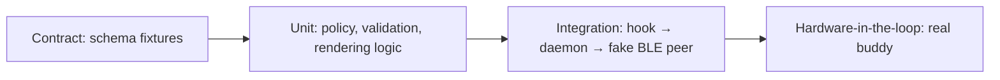

# Testing strategy

> **Pending to define.** Fill per component once stacks are chosen. The safety rules (no remote high-risk approval, single-use decisions) must have automated tests before phase 4 ships.

| Layer | What to test | Tool | Run |
| :--- | :--- | :--- | :--- |
| Contract | Valid fixture per type passes; each invalid fixture fails; scenarios emit only valid events | `node:test` + ajv | `pnpm test` |
| Unit (daemon) | Risk policy classification; decision validation (pending, expiry, single use, high-risk approve rejected); Swift types vs. shared fixtures | Swift Testing | `scripts/swift-test.sh` |
| Unit (firmware) | `buddy_model` (portable C): every shared fixture (valid accepted, invalid rejected except unknown fields), sort order, Home text, pet states, timers (idle 60 s, reminder 25 s, hold 900 ms, long press 650 ms, sleep clock shift), decisions; every message the buddy emits is validated against the schema | clang + UBSan, minimal harness in `firmware/test/` | `scripts/firmware-test.sh` |
| Integration | Hook payload → event → fake peripheral; reconnect sends `snapshot` | Swift Testing (`Coordinator` with fake link, clock, presence); manual run in `daemon/README.md` | `scripts/swift-test.sh` |
| Visual parity | Firmware screens vs. `prototypes/buddy-sim.html` | {{tool}} | {{cmd}} |
| Hardware | Pairing, two Macs, range loss, battery alerts | manual checklist | — |
