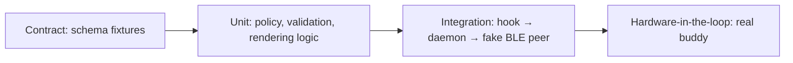

# Testing strategy

> **Pending to define.** Fill per component once stacks are chosen. The safety rules (no remote high-risk approval, single-use decisions) must have automated tests before phase 4 ships.

| Layer | What to test | Tool | Run |
| :--- | :--- | :--- | :--- |
| Contract | Valid fixture per type passes; each invalid fixture fails; scenarios emit only valid events | `node:test` + ajv | `pnpm test` |
| Unit (daemon) | Risk policy classification; decision validation (pending, expiry, single use, high-risk approve rejected); Swift types vs. shared fixtures | Swift Testing | `scripts/swift-test.sh` |
| Unit (firmware) | `buddy_model` (portable C) and the demo feed (2 h simulated, no rejected message): every shared fixture (valid accepted, invalid rejected except unknown fields), sort order, Home text, pet states, timers (idle 60 s, reminder 25 s, hold 900 ms, long press 650 ms, sleep clock shift), decisions; every message the buddy emits is validated against the schema | clang + UBSan, minimal harness in `firmware/test/` | `scripts/firmware-test.sh` |
| Integration | Hook payload → event → fake peripheral; reconnect sends `snapshot` | Swift Testing (`Coordinator` with fake link, clock, presence); manual run in `daemon/README.md` | `scripts/swift-test.sh` |
| Visual parity | Firmware screens vs. `prototypes/buddy-sim.html` | Manual, on the board ([hardware checklist](#hardware-checklist)) | — |
| Hardware | Pairing, two Macs, range loss, battery alerts, touch and timing feel | [Hardware checklist](#hardware-checklist) | — |

## Hardware checklist

Things only the board can confirm. Run them once flashing is approved; tick them in the commit that confirms them.

### Firmware phase 2 (views, pet, alerts, permission screen)

- [ ] All five views, the overlays, the permission screen, the sheets, the toast and the sleep clock render without clipping at 480×480; fonts legible at their sizes.
- [ ] Active view holds 30 fps or more with the pet animating (enable `LV_USE_PERF_MONITOR`); off-screen pets are not drawn.
- [ ] Pixel pets look crisp (nearest-neighbour) at 224, 192, 128, 76, 72 and 48 px.
- [ ] Overlay and permission backgrounds use vertical gradients instead of the prototype's radial ones (complex gradients are off in LVGL); check they read well on the AMOLED.
- [ ] Swipe left/right changes view; taps on agent rows, the usage ring, the Hilo card and sheet controls land on the right target; a swipe never also fires a tap.
- [ ] Hold to approve fires at ~900 ms; lifting early or sliding off the button cancels it.
- [ ] Side button on GPIO18: assumed active-low with the internal pull-up and a 40 ms debounce; click = back / Later / next view, hold 650 ms = sleep.
- [ ] Sleep clock is dim and moves every 6 s; tap or button wakes. Brightness is not lowered yet (no brightness policy).
- [ ] Confetti burst on "Task done" does not drop frames.
- [ ] Heap after boot: model and pets live in PSRAM (`model … bytes` log line); no allocation failures over an hour of demo feed.
- [ ] Not implemented yet, still demo values: battery from the AXP2101, writing the PCF85063 from the model clock, sound through the ES8311.
