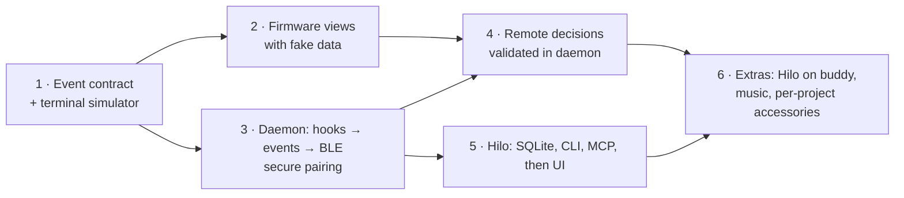

# Roadmap

> Initial outline. Detailed phase planning (deliverables, exit criteria, dependencies) is the next step and will replace this list.

| Phase | Outcome | Status |
| :--- | :--- | :--- |
| 1 | Event schema in `shared/` as single source of truth; a terminal tool that emits contract events | Done |
| 2 | Firmware renders all views and the pet from fake data, matching the simulator | All views, pet, alerts, permission screen and sheets drawn from the model; demo build verified on the board ([hardware checklist](../plans/testing-strategy.md#hardware-checklist)); battery, RTC write and sound still demo values |
| 3 | `hilod` turns Claude Code hooks into events and sends them over a bonded BLE link | Hook ingestion, risk policy, NimBLE peripheral and CoreBluetooth central with passkey pairing done and verified on the board (bond, MTU 517, snapshot, reconnects); unbonded central, two Macs and RPA not tested yet |
| 4 | Permission and question decisions from the buddy, validated by the daemon | Daemon side (registry, presence-based hold) and buddy permission screen with hold-to-approve done; end-to-end over BLE not yet tested |
| 5 | Hilo data layer (SQLite), CLI and MCP; then the macOS UI | Not started |
| 6 | Hilo view on the buddy, music view, per-project accessories | Not started |
