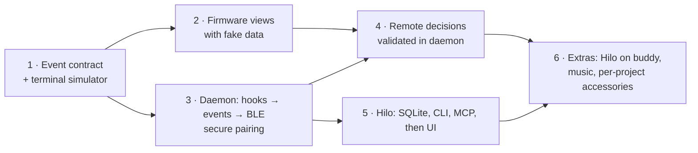

# Roadmap

> Initial outline. Detailed phase planning (deliverables, exit criteria, dependencies) is the next step and will replace this list.

Status as of 2026-10-27. Percentages are a judgement of what is left, not a count: code written and covered by host tests counts as done; a check that only the board, the apps or a person can make keeps a phase below 100 %. What is left on the board is spelled out in the [hardware checklist](../plans/testing-strategy.md#hardware-checklist); open decisions are in [open questions](../plans/open-questions.md).

| Phase | Outcome | Status | Left |
| :--- | :--- | :--- | :--- |
| 1 | Event schema in `shared/` as single source of truth; a terminal tool that emits contract events | **Done, 100 %** | — |
| 2 | Firmware renders all views and the pet from fake data, matching the simulator | **Code done, ~90 %.** All views, pet, alerts, permission screen, sheets, settings panel, Focus, Music, idle rotation and Claudio's face (with the 380 ms "sees the request", the 340 ms card slide and the sleep cross-fade) drawn from the model; host tests and render; demo build measured on the board (≥ 36 fps in every transition) | **Code:** task #35 (one random demo run showed the permission screen at 17–26 fps after a "Task done"; not reproduced). **Board, by eye or ear:** settings panel, idle rotation with a picture, Focus view and alarm, Claudio's eyes and the new slide / cross-fade, listening to the 17 cues, battery discharge run, clock after a full power-off. **Decision:** sound synthesis vs samples and default volume (after listening) |
| 3 | `hilod` turns Claude Code hooks into events and sends them over a bonded BLE link | **Code done, ~85 %.** Hook ingestion, risk policy, NimBLE peripheral and CoreBluetooth central with passkey pairing verified on the board (bond, MTU 517, snapshot, reconnects); usage from the status line reaches the buddy | **Board:** an unbonded central turned away, a Mac with a resolvable private address, two Macs at once with the heap during both snapshots, the status line wrapped and the ring matching `/usage`. **Decision:** replay window (recommendation: 120 s in `hilod`) |
| 4 | Permission and question decisions from the buddy, validated by the daemon | **Code done, ~75 %.** Registry, presence-based hold, hold-to-approve, high-risk block, redaction and the "Answer it on the Mac" hand-back; low-risk approval (synthetic and real session) and the high-risk block verified on the board; deny, answers and expiry covered by integration tests and `scripts/hilod-e2e.sh` | **Board:** Deny, a question answered on the buddy reaching a real session, a 600 s expiry, the hand-back by eye. **Decisions:** #21 (10 s of Mac activity before handing back), presence signal and "presence decided once", policy file, device lock, high-risk deny |
| 5 | Hilo data layer (SQLite), CLI and MCP; then the macOS UI | **~80 %.** Store, capture (commits, active time, tokens), CLI, MCP, the app's five screens, Setup, Focus, Week navigation and export, Liquid Glass bar; 2026-10-27 from dogfooding: resume digests the last session and reads git first, Week counts parallel sessions once, `add` / `agree` default to the current repo, a new prompt after Stop reads working | **Code:** #36 (files changed through the shell are missing from resume). **App or Mac, by hand:** Setup's rename, `hilo install` / Start and Stop, guided pairing from the app, the app by eye on macOS 26, tokens per session. **Decisions:** #6 weekly summary with Claude, Jira (not started), #34 auto-link of side sessions, session ↔ task default, distribution (login item, notarization), prototype fonts |
| 6 | Hilo view on the buddy, music view, per-project accessories | **~75 %.** Hilo and Music views, per-session pets, music producer with controls, real covers, Mac pictures and idle rotation, Pomodoro on buddy / `hilod` / Hilo with the end-of-phase alarm, time zone setting, Music and status line steps in Setup, Claudio's face | **Board or apps:** the Automation prompt under launchd and music end to end, covers on the AMOLED, pets per session across buddy and app, Music step in Setup. **Decisions:** #22 (confirm eyes v2; overlays over the Face or a toast), #5 Focus card while asleep, #13 two Macs on Spotify Connect, OTA |
