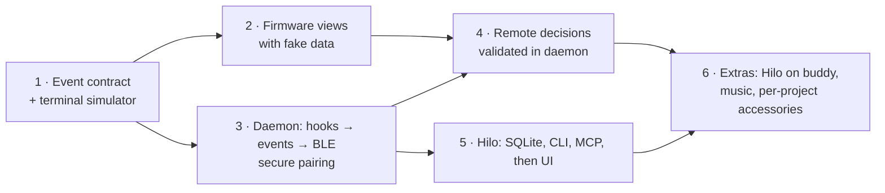

# Roadmap

> Initial outline. Detailed phase planning (deliverables, exit criteria, dependencies) is the next step and will replace this list.

| Phase | Outcome | Status |
| :--- | :--- | :--- |
| 1 | Event schema in `shared/` as single source of truth; a terminal tool that emits contract events | Done |
| 2 | Firmware renders all views and the pet from fake data, matching the simulator | All views, pet, alerts, permission screen and sheets drawn from the model; demo build verified on the board ([hardware checklist](../plans/testing-strategy.md#hardware-checklist)); battery (AXP2101) and RTC (PCF85063) read on the board; sound synthesized and played through the ES8311 behind a build option, not listened to yet; panel dims to 20 % on the sleep clock (verified over serial); battery logged every minute for a discharge run |
| 3 | `hilod` turns Claude Code hooks into events and sends them over a bonded BLE link | Hook ingestion, risk policy, NimBLE peripheral and CoreBluetooth central with passkey pairing done and verified on the board (bond, MTU 517, snapshot, reconnects); usage from the status line's `rate_limits` (and, opt-in, transcript tokens) reaches the buddy; unbonded central, two Macs and RPA not tested on the board yet (two Macs with a picture each, forgetting one and reusing its slot covered by host model tests) |
| 4 | Permission and question decisions from the buddy, validated by the daemon | Daemon side (registry, presence-based hold) and buddy permission screen with hold-to-approve done; a low-risk approval (synthetic and from a real Claude Code session) and the high-risk block verified on the board; deny, question answers and expiry covered by integration tests and a real `hilod` run (`scripts/hilod-e2e.sh`), left for the board: pressing Deny / answering on the buddy and a real session taking the answer; secrets in shown text are redacted; presence timing still open |
| 5 | Hilo data layer (SQLite), CLI and MCP; then the macOS UI | SQLite store, session recording in `hilod`, `hilo` CLI, MCP server, the SwiftUI app with all five screens, Setup (name, `hilod` as a LaunchAgent via Setup or `hilo install`, guided pairing; pairing and install not yet run on the dev Mac), automatic capture of commits, active time and per-session tokens, `hilo resume` / `hilo week --md`, JetBrains Mono bundled done; Focus section, week navigation and Export .md, Liquid Glass bar (macOS 26) with progressive blur and native title-bar behaviour done (glass checked only by eye); Pomodoro state survives a `hilod` restart; Jira not started (pending your decision); Claude-drafted weekly summary proposed in open questions, not built |
| 6 | Hilo view on the buddy, music view, per-project accessories | Buddy Hilo and Music views drawn; per-project hue and accessory derived from the project name, identical on the buddy and in Hilo; music producer in `hilod` (Spotify and Music.app over AppleScript) with play/pause/next/previous from the buddy (Automation prompt under launchd untested; denial retried every 5 min, AppleScript kept off the coordinator); device settings panel and Setup controls verified on the board; Mac pictures and idle rotation (transfer verified, layout checked in the host render `scripts/firmware-render.sh`, look on the AMOLED pending); Pomodoro on the buddy, `hilod` and Hilo (sync verified, view checked in the host render, touch and cue on the board pending); real album cover on the Music view (`media.cover`: Music.app artwork or Spotify cover from its CDN, scaled to 96×96 by `hilod`, pulled by the buddy; checked in the host render, apps and board pending); round music buttons; 2026-10-27: regenerating pixel cover, end-of-phase alarm with a Mac notification, time zone setting, Music step in Setup (`media_enabled`), status line prompt in Setup, and pets per session (`look`, `device.session_look`), all checked with tests and the host render, board checks pending; Claudio eyes prototype awaiting approval |
