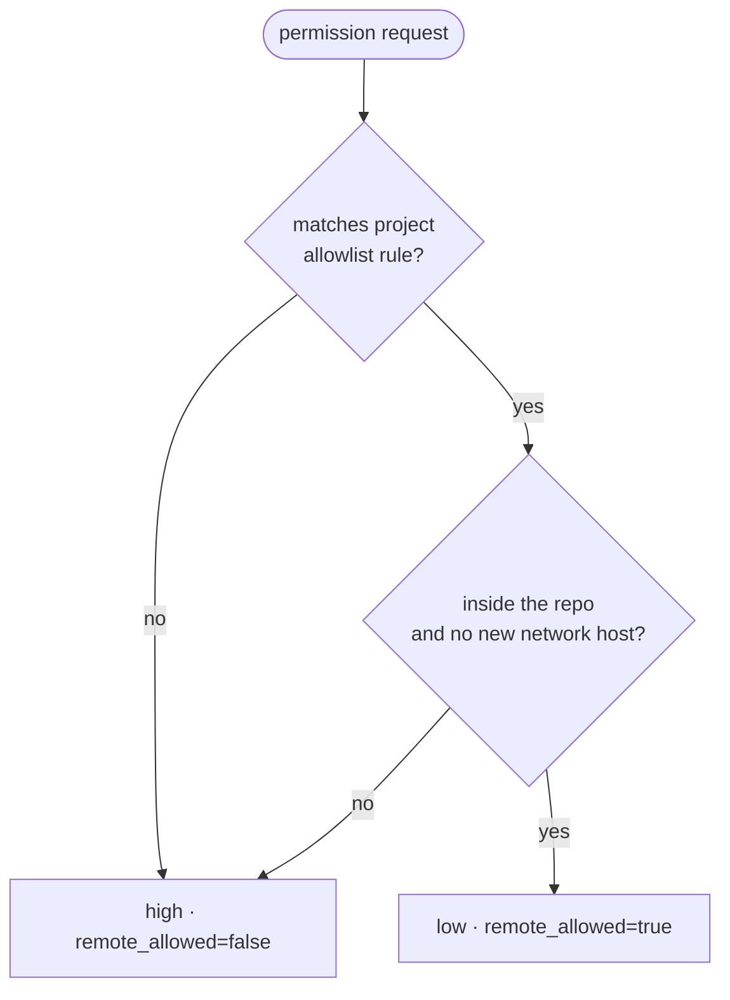

# Risk policy (draft)

The daemon classifies every permission request before it reaches the buddy. The buddy never classifies.

| Level | Examples | From the buddy |
| :--- | :--- | :--- |
| low | `Read`, `Edit` inside the repo, `npm test`, `npm install <pkg>@<exact-version>`, `WebFetch` | approve or deny |
| high | `terraform apply`, `git push --force`, `rm -rf`, deployments, any command outside the repo, network to new hosts | deny only |
| question | `AskUserQuestion` or equivalent | answer with one option |

- When in doubt: **high**.
- The policy is an editable, versioned file with an allowlist per tool and command pattern, configurable per project.

## Pending to define

See [open questions › daemon](../plans/open-questions.md#daemon): file location and format (e.g. `~/.config/hilo/policy.toml`), rule syntax, how "inside the repo" is determined (cwd vs. resolved paths), and what counts as a "new" network host.
